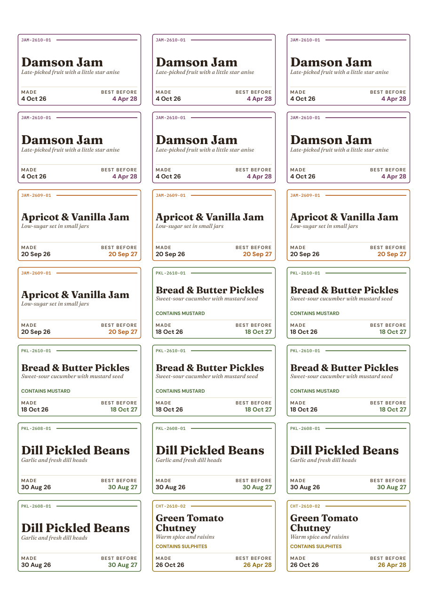
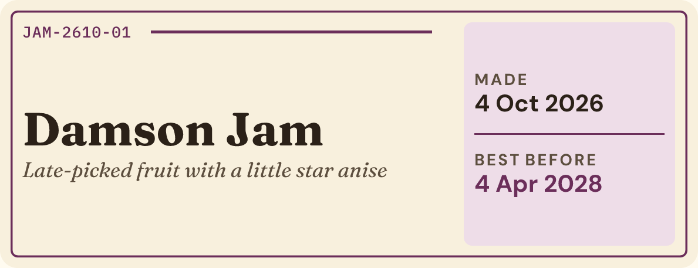
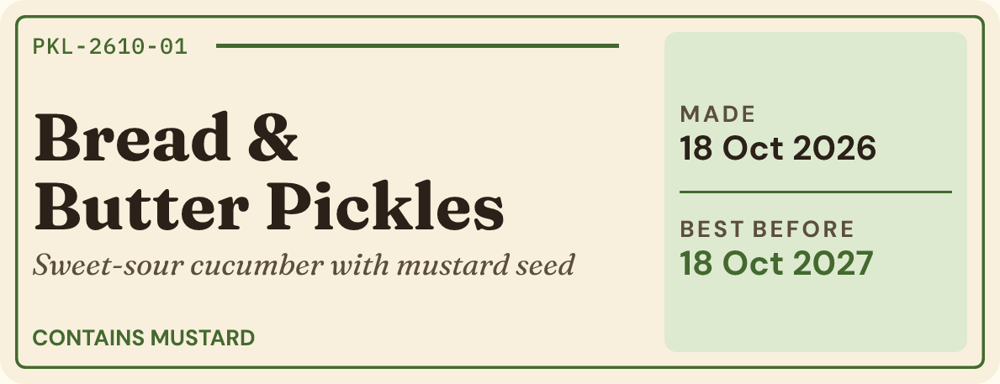
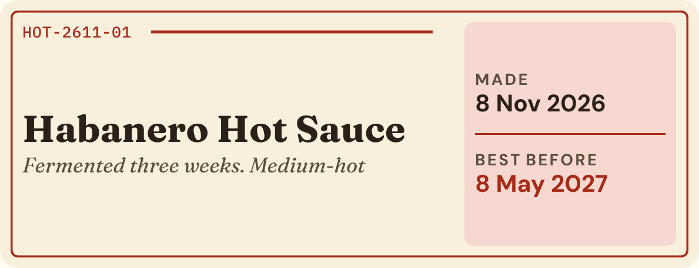
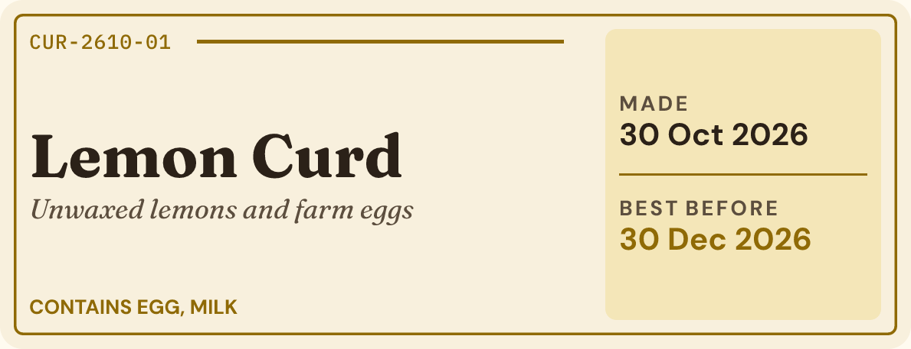
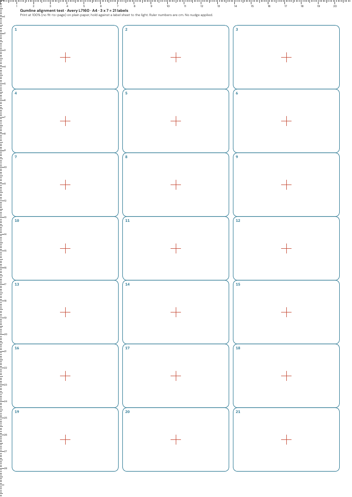
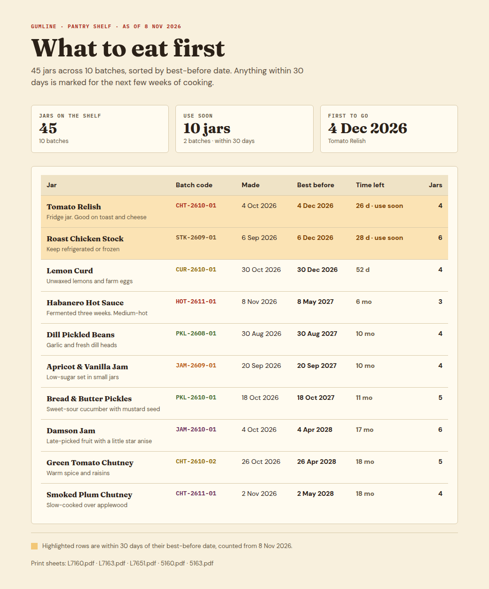
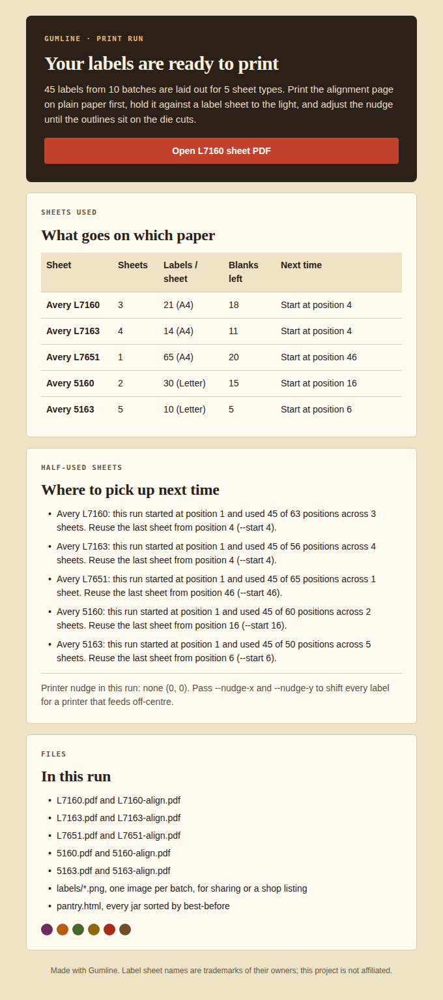
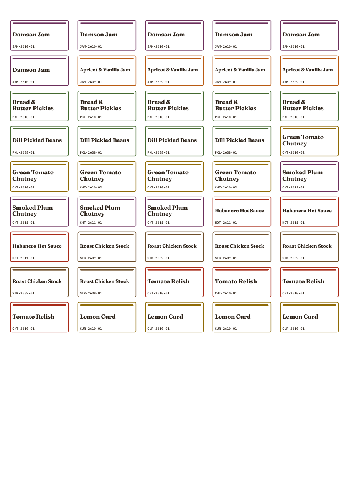
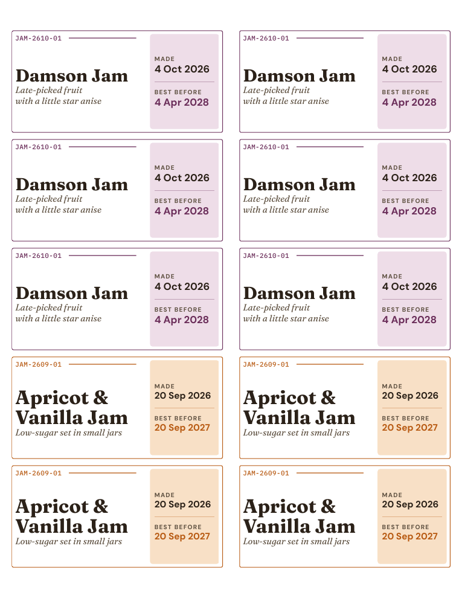

# Gumline

**One CSV in, labels out that actually line up on real label sheets.**

Gumline turns a spreadsheet of home-canned goods into print-ready label sheets for stock Avery layouts, plus an alignment test page, shareable label images, a pantry shelf page and a print-run summary email. Everything is rendered from one theme and one shared label component with [Hyper Elements](https://www.npmjs.com/package/@hyper-elements/react).



<p>
  
  
</p>
<p>
  
  
</p>

## Why it exists

- **Label templates in word processors drift.** A margin changes, a table cell grows, and by sheet three the text is crossing the die cut. Gumline places every label from the manufacturer's published geometry, in millimetres, and then measures the PDF it wrote to prove it (`npm run verify`).
- **Partly used sheets get thrown away.** `--start 8` skips the first seven positions so you can finish a half-used sheet, and the print-run email tells you which position to start from next time.
- **Printers feed off-centre.** `--nudge-x` and `--nudge-y` shift everything by a fraction of a millimetre, and the alignment sheet lets you see the result on plain paper before you spend a real sheet.

## Quick start

Needs a current Node.js (developed and tested on Node 26). `npm run previews` also needs `pdftoppm` (poppler) and a Chromium that `playwright-core` can find.

```bash
npm install
npm run build        # every sheet in the registry, demo CSV -> ./out
npm run check        # validate every Hyper Elements root + email client emulation
npm test             # 51 tests
npm run typecheck
```

Then open `out/L7160.pdf` (print at 100%, "actual size", no fit-to-page), or `out/pantry.html` in a browser.

Typical runs:

```bash
npm run build -- --sheet L7160 --start 8 --nudge-x 0.5
npm run build -- --sheet 5160,5163 --csv my-jars.csv --today 2026-12-01
npm run verify -- --start 8 --nudge-x 0.8 --nudge-y -0.5   # measure the PDFs against the registry
npm run previews                                           # rebuild ./previews (needs pdftoppm + Chromium)
```

## What comes out

| Folder / file | What it is |
| --- | --- |
| `out/<sheet>.pdf` | Print-ready label sheets. Vector, no raster. |
| `out/<sheet>-align.pdf` | Alignment test page: label outlines, crosshairs at each label centre, slot numbers and a mm ruler along the top and left edges. |
| `out/labels/*.png` | One PNG per unique label (about 300 dpi), for sharing or a shop listing. |
| `out/pantry.html` | Every jar sorted by best-before, with a "use soon" highlight. Fonts are copied to `out/fonts/`, so it works offline. |
| `out/print-run-email.html` / `.txt` | "Your print run is ready" summary: sheets used, labels per sheet, blanks left, where to start next time. |



The pantry shelf page and the print-run email (also rendered from the same theme):

<p>
  
  
</p>

## How it uses Hyper Elements

One theme (`defineTheme` in `src/theme.ts`) and one label component (`src/components/Label.tsx`) feed every output.

| Root | Renderer | Output | Source |
| --- | --- | --- | --- |
| `Document` | `renderPdf` | `out/<sheet>.pdf` | `src/templates/SheetDocument.tsx` |
| `Document` (with `Layer` + `Svg`) | `renderPdf` | `out/<sheet>-align.pdf` | `src/templates/AlignDocument.tsx` |
| `Canvas` | `renderImage` | `out/labels/*.png` | `src/templates/LabelCanvas.tsx` |
| `Page` | `render` | `out/pantry.html` | `src/templates/PantryPage.tsx` |
| `Email` | `render` | `out/print-run-email.html` + `.txt` | `src/templates/PrintRunEmail.tsx` |

Every root goes through `validate()` before it is rendered, and `npm run check` runs the email through the `@hyper-elements/email-clients` emulation (Outlook, Gmail, Apple Mail, Gmail app) and fails on errors.

Notes on how the layout is done, because Hyper Elements is a flow layout and has no absolute positioning:

- Each sheet page has no margin. A padded wrapper puts the first label at the sheet's top and left margin (plus the nudge), rows step by the label pitch, and a label slot is an empty fixed-size column when it is skipped.
- Hyper Elements snaps box **widths** to whole pixels (96 per inch), while heights and offsets stay exact. Labels such as L7163 (99.1 mm = 374.54 px) would drift, so each slot gets the whole-pixel width just inside the die cut and the remainder goes into the gap. Corner positions stay exact; a painted label background can be up to one pixel (0.26 mm) narrower than the die cut and is never wider.
- Text is fitted before rendering with real font metrics (`fontkit`), so every line of every label is chosen to fit its box. Nothing relies on `overflow: hidden`.

## Label design

Warm paper tones, a serif display face for names (Fraunces), a clean small face for dates (DM Sans), a mono face for batch codes (IBM Plex Mono), one accent colour per product, and a thin rule border inset **1.5 mm** from the die cut. All text stays inside that rule.

The content adapts to the label size, in four tiers:

| Tier | Used for | Content |
| --- | --- | --- |
| tiny | height under 23 mm (L7651) | accent bar, name (up to two lines), batch code |
| compact | under 30 mm (5160) | name, variety, best-before, batch code |
| standard | narrower than 90 mm (L7160) | batch code, name, variety, allergens, made and best-before |
| wide | 90 mm and wider (L7163, 5163) | name column, variety, allergens, and a tinted panel with made and best-before |

The same demo data on the smallest and the largest layouts (Avery L7651 and 5163):

<p>
  
  
</p>

Sheets print with no background fill by default (a tint floods ink and shows any misfeed, especially on L7160, which has no gap between rows). Pass `--tint` to print the paper tone. The PNGs always have it.

## Data

`data/pantry.csv` is the demo pantry. Columns:

| Column | Notes |
| --- | --- |
| `name` | Required. |
| `variety` | Optional. A line of notes shown on bigger labels. |
| `batch_date` | Required, `yyyy-mm-dd`. |
| `shelf_life_months` | Required, whole number. |
| `quantity` | Required. How many labels to print. |
| `allergens` | Optional, separated by `;` or `\|`. |
| `accent` | Optional colour key: `plum`, `apricot`, `pickle`, `gold`, `chili`, `stock`, `berry`, `slate`. |
| `code` | Optional prefix for the batch code. Defaults to the first three letters of the name. |

Derived fields:

- **Best-before** is batch date plus shelf life, in calendar months, with the day clamped to the end of the month (31 Jan + 1 month = 28 Feb, or 29 in a leap year). Dates are handled as integer year/month/day, so the result never depends on the machine's time zone.
- **Batch code** looks like `JAM-2611-03`: code, two-digit year and month of the batch, and the number of the batch with that code in that month, in CSV order.

`out/pantry.html` marks anything within 30 days of a reference date as "use soon". The reference date is `--today`, or by default the latest batch date in the CSV, so the output is deterministic.

## Sheet registry

`data/sheets.json` holds the geometry exactly as published, in the unit each manufacturer uses. Values come from the manufacturers' published template specs; **confirm them against the box** before a big print run. Corner radii are estimates (they are not part of the published geometry), so check those too.

| Sheet | Page | Label | Grid | Top | Left | H pitch | V pitch |
| --- | --- | --- | --- | --- | --- | --- | --- |
| Avery L7160 | A4 | 63.5 x 38.1 mm | 3 x 7 = 21 | 15.15 mm | 7.2 mm | 66.04 mm | 38.1 mm |
| Avery L7163 | A4 | 99.1 x 38.1 mm | 2 x 7 = 14 | 15.15 mm | 4.65 mm | 101.6 mm | 38.1 mm |
| Avery L7651 | A4 | 38.1 x 21.2 mm | 5 x 13 = 65 | 10.7 mm | 4.65 mm | 40.64 mm | 21.2 mm |
| Avery 5160 | US Letter | 2.625 x 1 in | 3 x 10 = 30 | 0.5 in | 0.1875 in | 2.75 in | 1 in |
| Avery 5163 | US Letter | 4 x 2 in | 2 x 5 = 10 | 0.5 in | 0.15625 in | 4.1875 in | 2 in |

### Add a sheet

Append an entry to `data/sheets.json`:

```json
{
  "id": "MY-1234",
  "brand": "Brand",
  "description": "What it is",
  "unit": "mm",
  "page": "A4",
  "label": { "width": 70, "height": 36 },
  "grid": { "columns": 3, "rows": 8 },
  "margin": { "top": 9, "left": 0 },
  "pitch": { "x": 70, "y": 36 },
  "cornerRadius": 2
}
```

`unit` is `"mm"` or `"in"`, `page` is `"A4"` or `"Letter"`. Then `npm run build -- --sheet MY-1234`. The label tier is chosen from the label size, and the tests check that labels sit inside the page, do not overlap, and that the demo labels fit.

## CLI

```
npm run build -- [options]

  --sheet <id[,id]>     Sheet(s) from data/sheets.json (default: all). Repeatable.
  --start <n>           First label position to use, 1-based, row by row (default 1).
                        --start 8 skips positions 1 to 7.
  --nudge-x <mm>        Shift every label right (negative: left).
  --nudge-y <mm>        Shift every label down (negative: up).
  --csv <file>          Label data (default data/pantry.csv).
  --today <yyyy-mm-dd>  Reference date for "use soon" (default: latest batch date).
  --png-sheet <id>      Sheet whose label size the PNGs use (default L7163).
  --tint                Print the warm paper tint on the sheets too.
  --out <dir>           Output folder (default ./out).
```

A nudge that would push labels off the page is an error, not a silent clamp. Positions are counted row by row, so on a three-column sheet position 8 is the second column of the third row.

The alignment sheet applies the same nudge to its outlines but not to its ruler, so you can read the offset straight off the ruler. Print it at 100% on plain paper and hold it against a label sheet to the light.

## Verification

- `npm test` runs 50 tests (`node:test`): geometry of every registry sheet (inside the page, no overlaps, count = columns x rows), start and nudge, pagination (`ceil((start-1+N)/perSheet)` pages and the blank count), best-before across month ends, CSV parsing, label fit on every sheet, `validate()` on every root, and a measurement of rendered PDFs.
- `npm run verify` renders every sheet and its alignment page, reads the drawing operators back out of the PDF and compares the first and last label corners with the registry (tolerance 0.05 mm).
- Builds are deterministic: running `npm run build` twice produces byte-identical PDFs, PNGs, HTML and email.

## Project layout

```
data/            pantry.csv, sheets.json
src/             build.ts, check.ts, geometry.ts, label-layout.ts, data.ts, dates.ts, theme.ts, ...
src/components/  Label.tsx (shared by every output)
src/templates/   SheetDocument, AlignDocument, LabelCanvas, PantryPage, PrintRunEmail
scripts/         verify.ts, previews.ts
previews/        images used in this README
```

## Credits

- [Hyper Elements](https://www.npmjs.com/package/@hyper-elements/react) (`@hyper-elements/react`, `@hyper-elements/email-clients`), MIT.
- [React](https://react.dev) and React DOM, MIT.
- [@react-pdf/renderer](https://react-pdf.org), MIT, and [satori](https://github.com/vercel/satori) and [@resvg/resvg-js](https://github.com/yisibl/resvg-js), MPL-2.0, which Hyper Elements uses for PDF and PNG output.
- [fontkit](https://github.com/foliojs/fontkit), MIT, for measuring text.
- Fonts via [Fontsource](https://fontsource.org), all SIL Open Font License 1.1: [Fraunces](https://github.com/undercasetype/Fraunces), [DM Sans](https://github.com/googlefonts/dm-fonts), [IBM Plex Mono](https://github.com/IBM/plex).
- Dev tools: `tsx` (MIT), TypeScript (Apache-2.0), `playwright-core` (Apache-2.0).

Avery and the sheet codes are trademarks of their owners. Gumline is not affiliated with, endorsed by or sponsored by any label manufacturer; sheet names are used only to say which layout a template matches.

## License

MIT. See [LICENSE](LICENSE).
